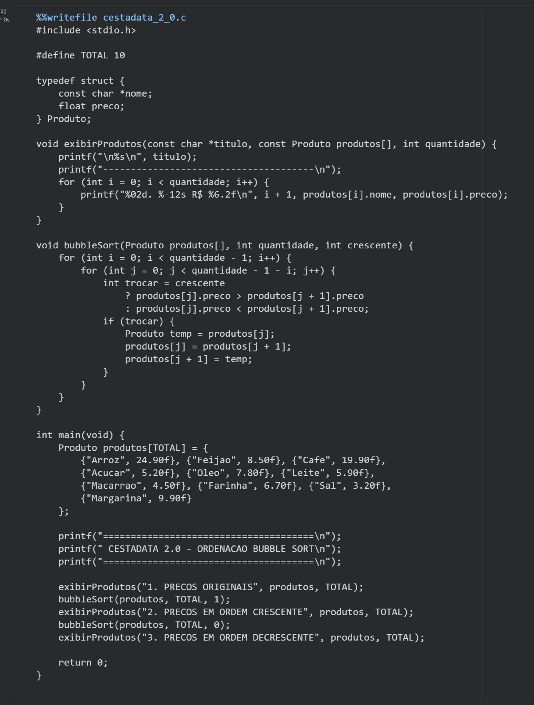
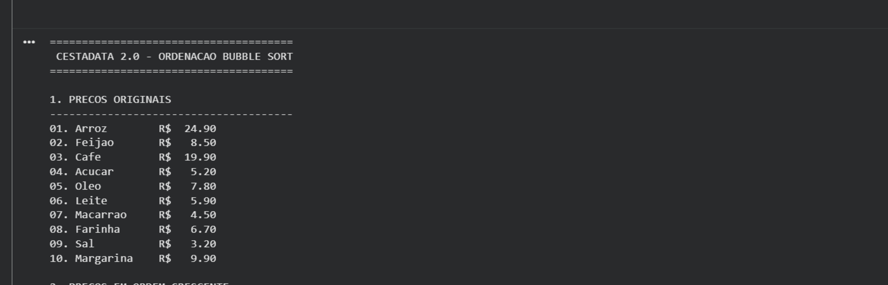
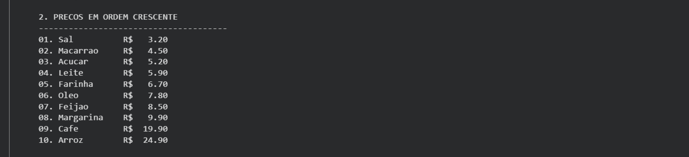
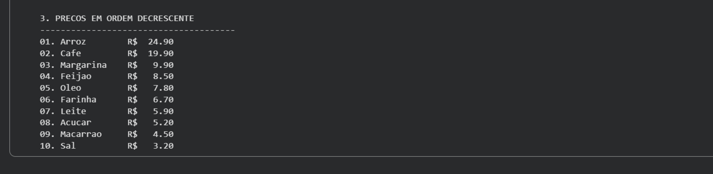
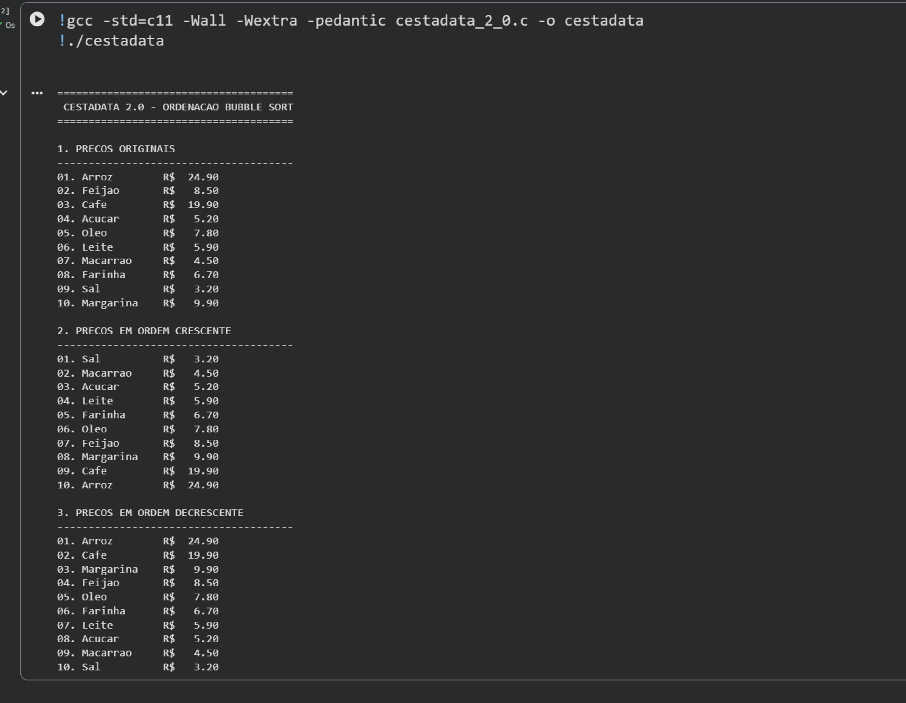

<h1 align="center">🛒 CestaData — Análise e Ordenação de Preços em C</h1>

<p align="center"><strong>Projeto acadêmico • Análise e Desenvolvimento de Sistemas • Algoritmos e Pensamento Computacional</strong></p>

<p align="center">


</p>

## 📌 Sobre o projeto

O **CestaData** faz parte da trajetória de aprendizagem em linguagem C na graduação em **Análise e Desenvolvimento de Sistemas**. A proposta utiliza preços *simulados* de produtos da cesta básica para exercitar organização e processamento de dados.

Esta publicação documenta a continuidade do projeto na **Experiência Prática IV**, que introduziu a ordenação de preços utilizando o algoritmo **Bubble Sort**.

## 🚀 Evolução do projeto

| Etapa | Objetivo | Material |
| --- | --- | --- |
| **Versão inicial** | Primeira atividade acadêmica do CestaData, anterior ao uso de Bubble Sort | Código-fonte original ainda não recuperado; será incorporado sem alterações quando disponível |
| **CestaData 2.0 — Experiência Prática IV** | Organizar 10 produtos com nome e preço e exibir as sequências original, crescente e decrescente | [Código em C](versoes/v2-bubble-sort/cestadata_2_0.c) · [Notebook Colab](versoes/v2-bubble-sort/CestaData_2_0_Colab.ipynb) |

> O código da etapa inicial **não foi recriado artificialmente**. Esta organização permite preservar a versão original assim que for localizada e comparar as duas implementações com fidelidade.

## ⚙️ O que a versão 2.0 faz?

- Armazena **10 produtos simulados** com nome e preço utilizando `struct Produto`;
- Exibe os produtos na sequência original;
- Executa **Bubble Sort crescente**, do menor para o maior preço;
- Executa **Bubble Sort decrescente**, do maior para o menor preço;
- Mantém nomes e preços associados ao trocar os registros;
- Utiliza funções para exibição e ordenação, evitando repetir a mesma lógica.

### 🧠 Como funciona o Bubble Sort?

O algoritmo percorre pares de elementos vizinhos e troca suas posições quando estão fora da ordem desejada. A cada passagem, os itens se aproximam de sua posição final. O projeto utiliza laços `for` aninhados e uma condição para selecionar a ordem crescente ou decrescente.

O Bubble Sort foi escolhido pelo **valor didático**: ele permite observar claramente comparações e trocas, embora não seja o método mais eficiente para grandes volumes de dados.

## ▶️ Como executar

Com GCC e suporte a C11:

```bash
gcc -std=c11 -Wall -Wextra -pedantic versoes/v2-bubble-sort/cestadata_2_0.c -o cestadata
./cestadata
```

Também é possível abrir o [notebook no Google Colab](versoes/v2-bubble-sort/CestaData_2_0_Colab.ipynb), executar suas células e observar a saída.

## 📷 Evidências da Experiência Prática IV

### 1. Código e ambiente de desenvolvimento


### 2. Preços na ordem original


### 3. Ordenação crescente


### 4. Ordenação decrescente


### 5. Execução completa


## 🎓 Aprendizagens

Este exercício reforçou os conceitos de **vetores, estruturas (`struct`), funções, laços aninhados, comparações e ordenação de registros**. A principal evolução foi implementar um algoritmo de ordenação preservando a correspondência entre o nome e o preço de cada produto.

---

<p align="center">💡 Aprendendo, construindo e evoluindo com projetos acadêmicos reais.</p>
