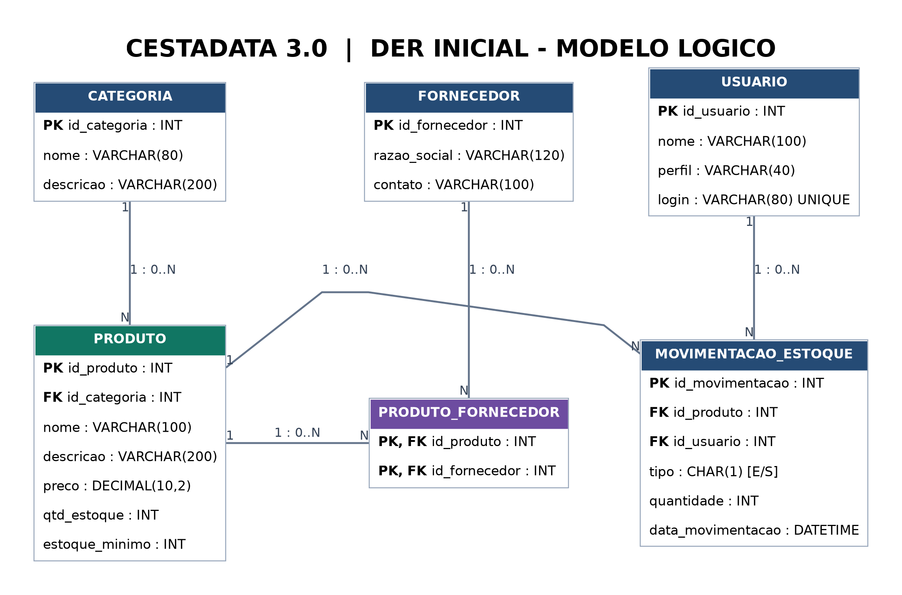
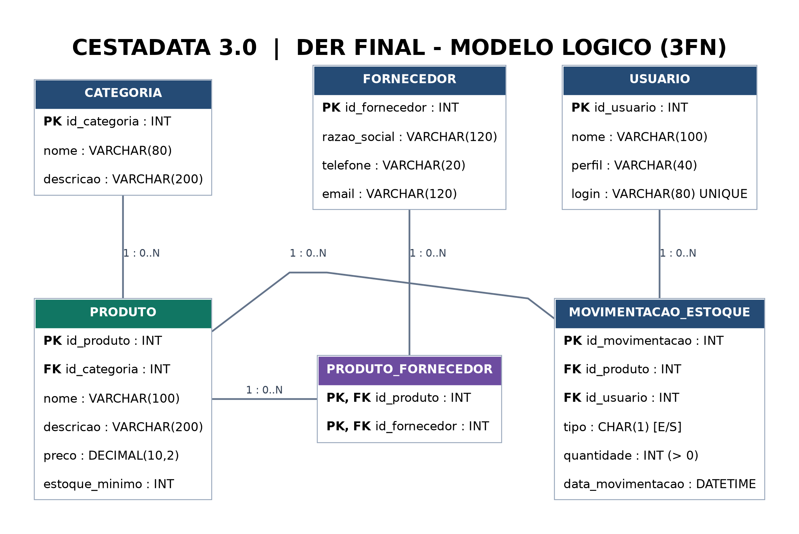
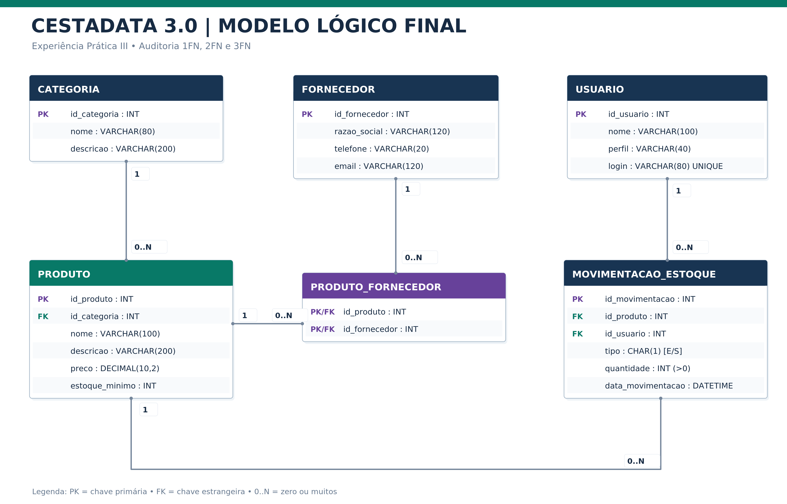

# CestaData 3.0 — Levantamento do Minimundo e Modelagem Inicial

**Projeto acadêmico | Evolução do CestaData | Análise e Desenvolvimento de Sistemas**

## Contexto

O CestaData começou com exercícios em linguagem C voltados ao registro, análise e ordenação de preços simulados de produtos. Na terceira etapa, o projeto passa a explorar o **levantamento do minimundo de um pequeno supermercado fictício**, preparando a compreensão dos dados necessários para uma futura solução de gestão de produtos e estoque.

Esta atividade é uma **documentação preliminar de análise e modelagem**, e não uma implementação nova de software. **Não foram criadas tabelas SQL nem um novo código C para esta etapa.**

## Objetivo do levantamento

Delimitar o funcionamento básico de um supermercado fictício e identificar quem utiliza as informações, quais processos precisam ser representados e que entidades compõem o domínio do problema.

## Escopo inicial

O estudo concentra-se na organização das informações sobre:
- Produtos e suas categorias;
- Fornecedores;
- Estoque e movimentações de entrada e saída;
- Consultas e relatórios operacionais.

O foco é construir uma visão lógica do problema antes de projetar tabelas ou implementar novas funcionalidades.

## Atores identificados

| Ator | Participação no processo |
| --- | --- |
| Gestor | Acompanha a operação e consulta relatórios de apoio à decisão |
| Estoquista | Registra entradas e saídas e acompanha a disponibilidade de produtos |
| Responsável pelo cadastro | Organiza e mantém os registros de produtos e informações relacionadas |

## Processos do minimundo

1. **Cadastro de produtos:** registrar e manter informações de itens.
2. **Movimentação de estoque:** acompanhar entradas e saídas.
3. **Atualização e consulta:** verificar informações disponíveis e situação do estoque.
4. **Relatórios:** transformar registros em informações úteis à gestão.

## Entidades preliminares

| Entidade | Papel no domínio |
| --- | --- |
| **Produto** | Representa os itens comercializados |
| **Categoria** | Permite classificar os produtos |
| **Fornecedor** | Representa a origem comercial dos produtos |
| **Movimentação de Estoque** | Representa os registros de entrada e saída dos itens |

Essas entidades foram identificadas na fase inicial de análise. Na continuidade da disciplina, elas foram detalhadas em diagramas DER, incluindo a entidade associativa `PRODUTO_FORNECEDOR` e a entidade `USUARIO`, como apresentado a seguir.

## Dado x informação

**Dado** é o registro isolado, como uma quantidade, um preço ou a identificação de um produto. **Informação** surge quando os dados são organizados e contextualizados para responder a perguntas operacionais — por exemplo, quais produtos precisam de reposição ou como o estoque está se movimentando.

### Dados estruturados e não estruturados

- **Estruturados:** códigos, nomes, categorias, quantidades, preços e registros de movimentação organizados em campos definidos.
- **Não estruturados:** fotografias e documentos associados aos produtos e fornecedores, caso façam parte de uma evolução futura.

O núcleo inicial do estudo prioriza dados estruturados.

## Evolução da modelagem — diagramas DER

Na continuidade das aulas de Modelagem de Dados, o estudo passou do levantamento do minimundo para a **representação das entidades, seus atributos, chaves e relacionamentos**.

### DER inicial — modelo lógico



O diagrama inicial identifica **seis entidades**: `CATEGORIA`, `PRODUTO`, `FORNECEDOR`, `PRODUTO_FORNECEDOR`, `USUARIO` e `MOVIMENTACAO_ESTOQUE`. Foram definidos identificadores primários (PK), referências entre entidades (FK) e as cardinalidades.

### Relacionamentos definidos

| Relacionamento | Cardinalidade do DER inicial | Interpretação |
| --- | --- | --- |
| **Categoria → Produto** | 1 : 0..N | Uma categoria pode reunir vários produtos; cada produto referencia uma categoria |
| **Produto → Produto_Fornecedor** | 1 : 0..N | Um produto pode participar de vários vínculos com fornecedores |
| **Fornecedor → Produto_Fornecedor** | 1 : 0..N | Um fornecedor pode aparecer em vários vínculos com produtos |
| **Produto → Movimentação_Estoque** | 1 : 0..N | Um produto pode possuir diversos registros de movimentação |
| **Usuário → Movimentação_Estoque** | 1 : 0..N | Um usuário pode registrar diversas movimentações |

**Produto × Fornecedor — relação muitos-para-muitos (N:N):** na modelagem, essa associação foi resolvida com a entidade `PRODUTO_FORNECEDOR`, que possui `id_produto` e `id_fornecedor` como **chaves estrangeiras e componentes de uma chave primária composta**. Assim, um produto pode estar associado a vários fornecedores, e um fornecedor pode estar associado a vários produtos.

**Movimentações de estoque:** cada registro está ligado a um produto e a um usuário por chaves estrangeiras. O modelo contempla o tipo de movimentação (`E` para entrada e `S` para saída), quantidade e data.

### DER final — etapa de normalização até a 3FN



A segunda imagem registra o **modelo final produzido na atividade de normalização até a Terceira Forma Normal (3FN)**. Essa etapa busca organizar atributos e dependências de forma consistente, reduzindo redundâncias e riscos de anomalias de atualização.

As imagens foram preservadas como produzidas na atividade. A descrição detalhada das cardinalidades acima é fundamentada no **DER inicial**; eventuais diferenças específicas entre o inicial e o final devem ser verificadas diretamente nos diagramas, sem presumir mudanças não documentadas.

> **Estágio do projeto:** os DERs são entregas de **modelagem**, não comprovação de implantação de banco de dados ou de comandos SQL executados. O código da versão 2.0 segue disponível separadamente.

---

## Atualização da EP3 — DER lógico final

Na continuidade das aulas, foi elaborado um **novo Diagrama Entidade-Relacionamento lógico final**, reunindo os conceitos de entidades, atributos, chaves primárias (PK), chaves estrangeiras (FK), cardinalidades e normalização.



[🔎 Abrir o DER lógico final em tamanho completo](../../imagens/CestaData_3_0_DER_Logico_Final_EP3.png)

### Evolução do controle de estoque

Uma decisão importante do modelo revisado foi **representar a movimentação como fonte dos dados de entrada e saída**, em vez de manter a quantidade atual como um campo redundante na entidade `PRODUTO`.

Assim, o **saldo de estoque pode ser calculado** a partir dos registros de `MOVIMENTACAO_ESTOQUE`, considerando entradas (`E`) e saídas (`S`):

```text
Saldo do produto = soma das entradas − soma das saídas
```

**Por que essa escolha importa?** Evita que um valor de saldo armazenado separadamente fique desatualizado em relação às movimentações, além de reforçar a importância da consistência dos dados. A consulta de saldo e suas regras de validação ainda precisarão ser implementadas e testadas em SQL em uma etapa posterior.

### Estrutura e relacionamentos do DER lógico

O modelo final mantém as seis entidades do domínio: **CATEGORIA**, **PRODUTO**, **FORNECEDOR**, **PRODUTO_FORNECEDOR**, **USUARIO** e **MOVIMENTACAO_ESTOQUE**.

- **Categoria → Produto (1:N):** uma categoria agrupa vários produtos;
- **Produto ↔ Fornecedor (N:N):** associação resolvida por `PRODUTO_FORNECEDOR`, que vincula suas chaves;
- **Produto → Movimentação_Estoque (1:N):** cada movimentação se refere a um produto;
- **Usuário → Movimentação_Estoque (1:N):** cada movimentação é registrada por um usuário.

### Normalização — 1FN, 2FN e 3FN

Na revisão acadêmica do DER, foram considerados a **atomicidade dos atributos (1FN)**, a organização das dependências em relação às chaves (2FN) e a ausência de **dependências transitivas indevidas** entre atributos não chave (3FN).

Este diagrama representa a **conclusão da etapa de modelagem lógica da EP3**, não a implementação de um banco relacional já executado.

### Histórico visual

1. [DER inicial — primeiro levantamento](../../imagens/CestaData_3_0_DER_Inicial.png)
2. [DER final — estudo de 3FN](../../imagens/CestaData_3_0_DER_Final_3FN.png)
3. [**DER lógico final — EP3 (mais recente)**](../../imagens/CestaData_3_0_DER_Logico_Final_EP3.png)

---

## Relação com as etapas anteriores

| Etapa | Principal aprendizado |
| --- | --- |
| **1.0** | Registros de preços e cálculos básicos |
| **2.0** | Organização de produtos com `struct`, vetores e Bubble Sort |
| **3.0** | Minimundo, relacionamentos, chaves, normalização e DER lógico final da EP3 |

A terceira etapa amplia a abordagem: além de **processar dados**, é necessário entender **quais dados o sistema deve representar, quem os utiliza e para quais decisões**.

## Possíveis próximas etapas

- Detalhar os atributos e regras de negócio;
- Revisar e refinar os diagramas entidade-relacionamento e as regras de negócio;
- Validar as decisões de normalização e evoluir para uma implementação em SQL;
- Conectar a modelagem com uma futura versão funcional do CestaData.

Esses pontos são **possibilidades de evolução**, não funcionalidades já desenvolvidas.

---

> **Transparência:** este documento consolida o levantamento realizado na atividade acadêmica do CestaData 3.0 para fins de portfólio. O trabalho segue como estudo de caso fictício, sem uso de dados reais de supermercado.
