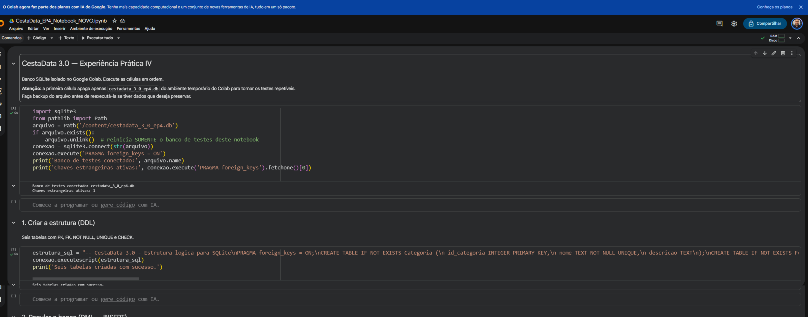
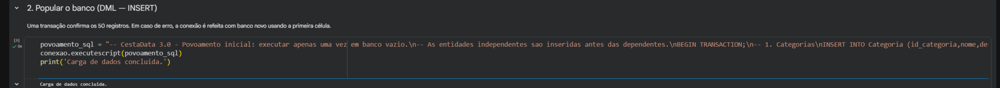
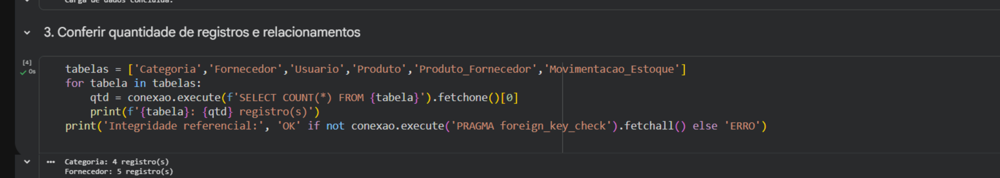
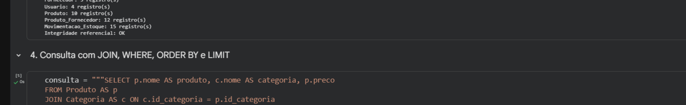
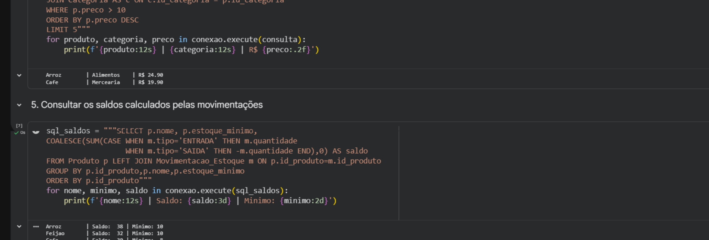
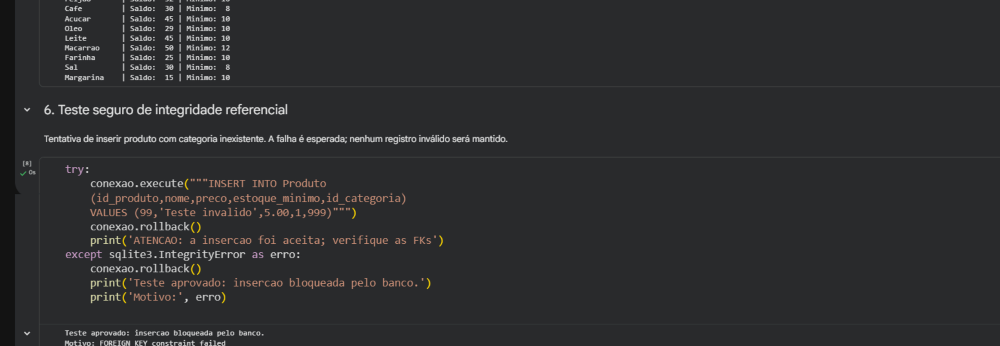

# CestaData 3.0 — Experiência Prática IV: SQLite no Google Colab

**Disciplina:** Modelagem de Banco de Dados · **Etapa:** Implementação e manipulação de dados  
**Tecnologias:** SQL, SQLite, Python (`sqlite3`) e Google Colab  
**Natureza:** atividade acadêmica com dados fictícios

## Da modelagem à implementação

Após o levantamento do minimundo e a elaboração dos DERs, a Experiência Prática IV levou o CestaData 3.0 à **criação de um banco de dados relacional**, ao povoamento de tabelas, à consulta dos registros e aos testes de integridade.

Os arquivos SQL e o notebook publicados nesta pasta foram recuperados dos materiais originais da atividade.

## Estrutura do projeto

| Arquivo | Finalidade |
| --- | --- |
| [`01_estrutura.sql`](01_estrutura.sql) | DDL: criação das seis tabelas e restrições |
| [`02_povoamento.sql`](02_povoamento.sql) | DML: carga fictícia inicial |
| [`CestaData_3_0_EP4_Colab.ipynb`](CestaData_3_0_EP4_Colab.ipynb) | Notebook original da atividade, com criação, povoamento, consultas e testes |

### Tabelas criadas

`Categoria`, `Fornecedor`, `Usuario`, `Produto`, `Produto_Fornecedor` e `Movimentacao_Estoque`.

A estrutura contempla chaves primárias e estrangeiras, **chave composta** na associação Produto × Fornecedor e restrições como `NOT NULL`, `UNIQUE` e `CHECK`.

### Povoamento inicial

| Tabela | Registros |
| --- | ---: |
| Categoria | 4 |
| Fornecedor | 5 |
| Usuario | 4 |
| Produto | 10 |
| Produto_Fornecedor | 12 |
| Movimentacao_Estoque | 15 |
| **Total** | **50** |

Os registros utilizam nomes e dados de demonstração fictícios.

## Evidências no Google Colab

Os prints da atividade foram preservados na pasta [`imagens/`](../../../imagens/) do repositório.

### 1 — Conexão e criação das tabelas (DDL)


### 2 — Inserção dos dados (INSERT)


### 3 — Validação dos registros


### 4 — Consulta com JOIN


### 5 — Cálculo do saldo do estoque


### 6 — Integridade referencial


### Outras consultas e operações

- [Consulta de produtos](../../../imagens/07_consulta_produtos.png)
- [Atualização de preço do arroz (UPDATE)](../../../imagens/08_atualizacao_arroz_update.png)
- [Consultas exploratórias em SQL](../../../imagens/09_consultas_exploratorias_sql.png)
- [Resultados das consultas SELECT](../../../imagens/10_resultados_consultas_select.png)

## Consultas e conceitos aplicados

- **DDL:** `CREATE TABLE`, definição de PKs e FKs, restrições e relacionamento N:N;
- **DML:** `INSERT` para o povoamento inicial e estudos de `UPDATE` e `DELETE`;
- **DQL:** `SELECT`, `JOIN`, `WHERE`, `ORDER BY`, `LIMIT`, agregações e `GROUP BY`;
- **Integridade:** `PRAGMA foreign_keys = ON` e teste de inserção de referência inexistente;
- **Estoque:** saldo calculado a partir de movimentações do tipo `ENTRADA` e `SAIDA`, em vez de um campo duplicado em `Produto`.

Exemplo de consulta ao catálogo:

```sql
SELECT p.nome AS produto, c.nome AS categoria, p.preco
FROM Produto AS p
JOIN Categoria AS c ON c.id_categoria = p.id_categoria
WHERE p.preco > 10
ORDER BY p.preco DESC
LIMIT 5;
```

## Como executar

### Opção A — Google Colab

1. Abra o [notebook da EP4](CestaData_3_0_EP4_Colab.ipynb) no Google Colab.
2. Execute as células na ordem apresentada.
3. Observe a criação do banco, a carga inicial e os resultados das consultas.

**Atenção:** a primeira célula apaga o arquivo de teste `/content/cestadata_3_0_ep4.db`, se ele existir, antes de recriá-lo. Faça backup antes de reexecutá-la caso deseje preservar dados.

### Opção B — SQLite local

Abra um banco SQLite novo e execute, nesta ordem:

1. `01_estrutura.sql` para criar as tabelas;
2. `02_povoamento.sql` para inserir os dados;
3. As consultas apresentadas no notebook.

Ative `PRAGMA foreign_keys = ON` em cada conexão para aplicar as restrições de FK. O script de povoamento utiliza IDs fixos, portanto foi preparado para **execução única em banco vazio**.

## Limites técnicos e melhorias futuras

Este projeto tem finalidade **educacional**, não representa um sistema pronto para produção. Para evolução, é importante estudar tratamento de transações, impedimento de saída maior que o saldo disponível, tipos adequados para valores monetários, validação de operações e consultas analíticas para BI.

> A execução registrada nos prints foi feita no Google Colab. O notebook publicado preserva as células de estudo; não representa um aplicativo web nem autenticação de usuários.
